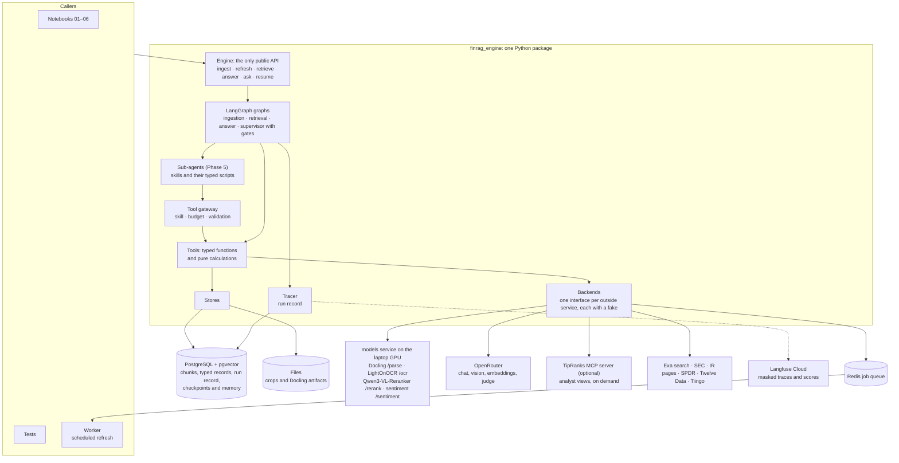
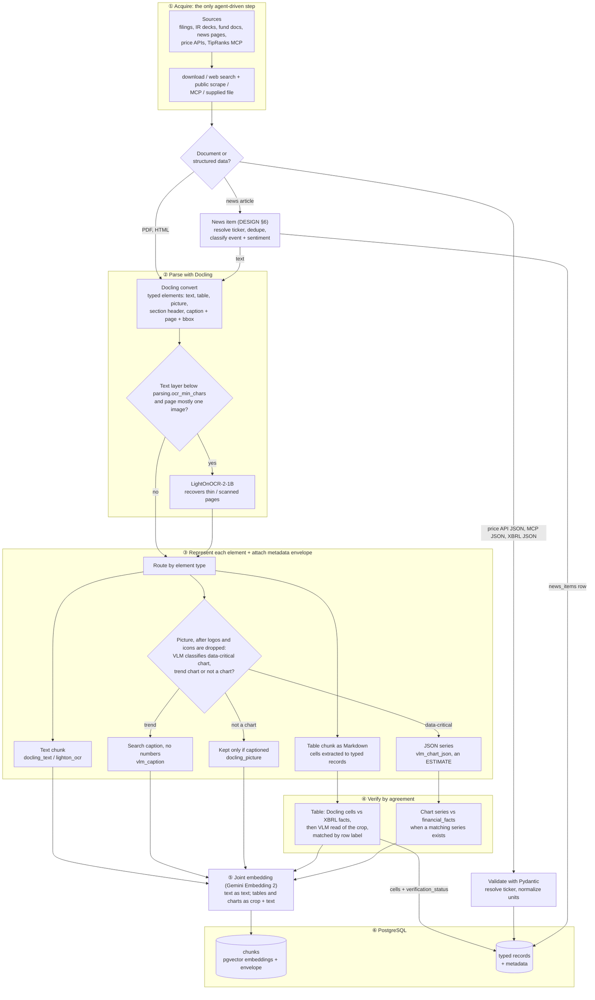
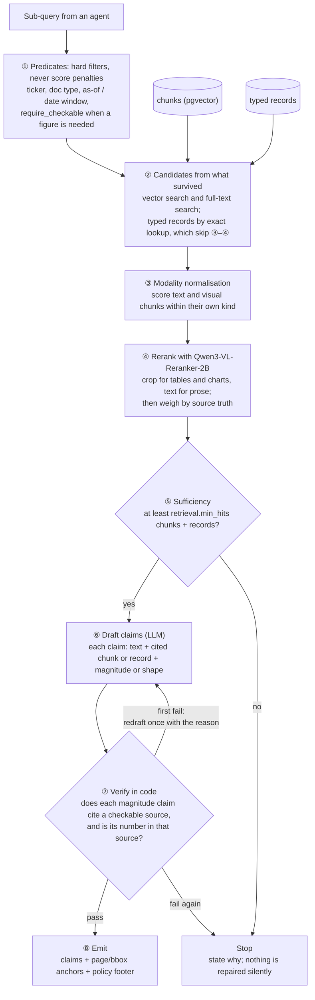
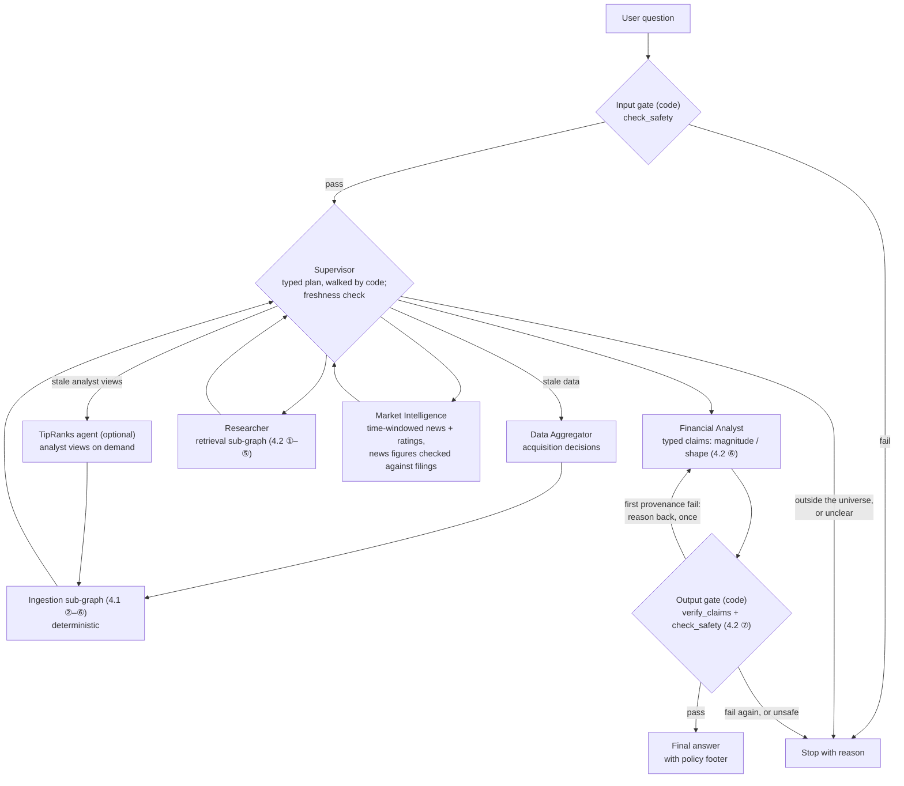
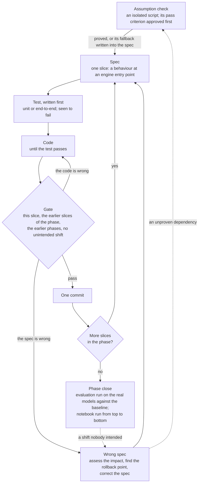

# Capstone Proposal: A Financial AI Agent Assistant

**Author:** C. de Montaigu
**Date:** 2026-09-27, revised 2026-10-07
**Course grounding:** *Agentic AI for Finance* (4-day course) + *AI Agents: The Definitive Guide* by Nicole Königstein (O'Reilly, [github.com/Nicolepcx/ai-agents-the-definitive-guide](https://github.com/Nicolepcx/ai-agents-the-definitive-guide))
**Companion:** [docs/DESIGN.md](docs/DESIGN.md) holds the implementation detail: tools and skills, data model, project structure, runtime and infrastructure, configuration, traceability, and memory.

---

## 1. Summary

This capstone builds a **financial AI agent assistant** that answers analyst-style questions about ETFs and equities, with every figure traceable to its source. It is a multimodal Retrieval-Augmented Generation (RAG) system with two pipelines:
- an **ingestion** pipeline builds the corpus from curated downloads and agent-driven web search over PDFs (text, tables and charts), web pages, daily price data, news and analyst ratings;
- a **retrieval** pipeline answers from that corpus only.

The target is a **supervised multi-agent LangGraph system**, built incrementally. Phases 1–4 build and evaluate the two pipelines. Phase 5 wraps them as sub-agents under a supervisor with safety guardrails, so nothing built earlier is thrown away.

The deliverable is a Python **AI engine**, a package of tools and LangGraph graphs, driven from Jupyter notebooks that act as thin wrappers. Moving the engine into a LangGraph-compatible agent harness is future work, outside the capstone's scope.

The build phases apply the course material day by day:

| Day | Course focus | Capstone phase |
|---|---|---|
| 1 | Harness design, chunking, retrieval, structured extraction | Phases 1–2: ingestion + RAG core |
| 2 | Multimodal RAG: Docling parsing, OCR routing, table/chart representation, multimodal embedding + reranking, provenance-gated answers | Phase 1: parsing + retrieval; Phase 2: table verification; Phase 3: charts + provenance rule |
| 3 | Evaluation harnesses, trajectory ranking | Phase 4: evaluation, extended to the agents in Phase 5 |
| 4 | Agent safety, multi-agent teams, memory, cost | Phase 5: multi-agent + guardrails |

**Out of scope:** time-series forecasting, portfolio management, audio processing, looking through ETFs to their holdings, and productionization into an agent harness.

## 2. Problem and Goal

Financial analysis draws on heterogeneous sources: PDF filings and reports, investor-relations pages, structured XBRL data and charts. Naive single-shot RAG breaks down on them for three reasons:
- layouts are table-heavy;
- claims must be cited precisely;
- answers need both **narrative text** and **exact numbers**.

A further risk is specific to multimodal RAG: a chart read by a vision model can produce a number that looks well sourced but is only an estimate.

**Goal:** an assistant that ingests real documents, answers with grounded citations, keeps estimated figures apart from checkable ones, and has measurable retrieval and answer quality. It is built incrementally, one runnable phase at a time.

## 3. Scope and Data

### 3.1 Corpus

One file, `data/raw/ListEquities.csv` (`ticker`, `name`, `type` = ETF / Equity, `sector`), defines the corpus. Adding a row adds an instrument, and the `type` column routes it to the right sources with no code changes. Source URLs are data too, in `config/sources.yaml`: per-type templates, plus the investor-relations page for an equity.

The starting corpus has **19 instruments**:
- the 11 SPDR Select Sector ETFs, one per S&P 500 GICS sector;
- the "Magnificent 7";
- IonQ, a small-cap, pre-profit contrast from outside the S&P 500.

ETFs are single instruments: their holdings are never fetched. Equities get SEC filings, IR decks and fundamentals; ETFs get fund documents and prices (coverage rules in [DESIGN §1](docs/DESIGN.md#1-instruments-and-data-coverage)).

<b>The 19 instruments</b> (11 ETFs + 8 equities)

| Type | Ticker | Name | Sector |
|---|---|---|---|
| ETF | XLC | Communication Services Select Sector SPDR Fund | Communication Services |
| ETF | XLY | Consumer Discretionary Select Sector SPDR Fund | Consumer Discretionary |
| ETF | XLP | Consumer Staples Select Sector SPDR Fund | Consumer Staples |
| ETF | XLE | Energy Select Sector SPDR Fund | Energy |
| ETF | XLF | Financial Select Sector SPDR Fund | Financials |
| ETF | XLV | Health Care Select Sector SPDR Fund | Health Care |
| ETF | XLI | Industrial Select Sector SPDR Fund | Industrials |
| ETF | XLB | Materials Select Sector SPDR Fund | Materials |
| ETF | XLRE | Real Estate Select Sector SPDR Fund | Real Estate |
| ETF | XLK | Technology Select Sector SPDR Fund | Information Technology |
| ETF | XLU | Utilities Select Sector SPDR Fund | Utilities |
| Equity | AAPL | Apple Inc. | Information Technology |
| Equity | MSFT | Microsoft Corporation | Information Technology |
| Equity | NVDA | NVIDIA Corporation | Information Technology |
| Equity | GOOGL | Alphabet Inc. (Class A) | Communication Services |
| Equity | META | Meta Platforms, Inc. | Communication Services |
| Equity | AMZN | Amazon.com, Inc. | Consumer Discretionary |
| Equity | TSLA | Tesla, Inc. | Consumer Discretionary |
| Equity | IONQ | IonQ, Inc. | Information Technology |

### 3.2 Sources

<b>The 8 sources</b> (what each provides and how it is used)

| Source | Content | Use |
|---|---|---|
| [SEC EDGAR](https://www.sec.gov/cgi-bin/browse-edgar) | 10-K / 10-Q / 8-K filings and their structured XBRL data | Narrative and tabular disclosures; reported figures from XBRL, the facts of record |
| Company investor-relations pages | Annual reports, earnings decks, press releases (PDF/HTML) | Multimodal text + tables + charts; company news |
| State Street SPDR fund pages | Fact sheets, prospectuses, annual reports (PDF) | Fund-level documents for the 11 ETFs |
| [Twelve Data](https://twelvedata.com) (primary) / [Tiingo](https://www.tiingo.com) (fallback) | Daily prices through their APIs, one free key each | Structured figures to cross-check filings and charts; one year of daily prices for 1-week, 1-month and 3-month trends |
| [TipRanks](https://www.tipranks.com) (subscriber) | Analysts' rating actions, its own consensus, the six model ratings of its AI stock analysis, bull and bear points, a catalyst summary, and the earnings estimates and company KPIs that SEC filings lack, via its MCP server | Enriches the market brief: analyst consensus computed in code, the rest reported apart. Fetched on demand, metered, and kept in the local database under its terms of use |
| Third-party analyst report PDFs, supplied by hand | Two-column cards, borderless tables, vector charts | A demanding layout for Docling; third-party figures are weighed below filings |
| [Exa](https://exa.ai) search API | Agentic web search: third-party news articles and public pages | Secondary coverage per ticker, ingested into the corpus |
| Earnings-call transcripts (e.g. Motley Fool) | Text | Management commentary and guidance |

Data is acquired four ways:
- direct download;
- agentic web search (Exa) and public scraping (custom code);
- the TipRanks MCP server;
- a file supplied by hand, for a document with no permitted automated path, such as an analyst report PDF.

**Web search is acquisition only.** Search results are ingested into the corpus before anything can cite them; no answer quotes a live web result. Credentials stay in `.env` and never reach an LLM prompt. TipRanks supplies analyst data and the fundamentals that SEC filings lack (earnings estimates, company KPIs): switched off, the engine runs without it and an answer says those figures are unavailable. Its data is metered and private: it is fetched only when a question needs it, it is kept in the local database and never in the repository, and it never enters the evaluation set ([DESIGN §2](docs/DESIGN.md#2-data-acquisition)).

## 4. Architecture

One Python package, the engine, sits between its callers and every outside system. The diagram shows what talks to what. Sections 4.1 to 4.3 then show how ingestion, retrieval and the agents flow, and 4.4 shows what runs where.

- **The engine's API is a Python object, not a web service.** Notebooks, tests and the worker all call the same five methods. The only HTTP endpoints the project owns are on the `models` service, which serves the four local models to the engine.
- **The tool gateway is inside the engine.** A sub-agent calls a skill's typed script and the script calls tools. Both calls pass through the gateway, where the skill's own tool list and the run's budget are checked. The pipelines call their tools directly, in an order fixed in code.
- **Every outside system sits behind one backend interface with a fake,** so the engine is tested without a key, a GPU or a network.

The RAG core is **two pipelines sharing one PostgreSQL database**: pgvector holds the chunk embeddings, and relational tables hold typed records.
- **Ingestion** runs on a schedule in the worker, and when a question finds an instrument's data stale: inline for prices and news, queued to the worker for documents. Analyst views from a provider are fetched only when a question needs them. It is the only writer to the corpus.
- **Retrieval** runs once per agent sub-query and only reads.

Both follow the process implemented in the course's Day 2 notebooks.

### 4.1 Ingestion

Only step ① is agent-driven: in Phase 5 the Data Aggregator decides which sources to fetch and which web searches to run (in Phases 1–4 and in scheduled refreshes, acquisition follows the configured source list for each instrument type, with no agent). Steps ②–⑥ are a **deterministic LangGraph sub-graph**. Its control flow is fixed, and models are called only at fixed steps: OCR, chart classification and reading, table re-reads, news sentiment, and safety screening of untrusted text. What an agent fetches comes back to it as a receipt, never as content, so fetched data stays out of every model's context. That holds for the TipRanks agent too: it triggers one fetch, written as code, and reads a receipt.

- **Typed elements, not a text dump.** Docling returns each element with its page and bounding box, and tables and charts are cropped before a vision model reads them. Scanned pages, measured by how little text layer they have, go to LightOnOCR; that is a measurement, not a model decision.
- **Each element gets the representation it needs.** Text is chunked under its heading path. Tables become Markdown, and their cells become typed records. Logos and icons are dropped by Docling's own classifier; a vision model then classifies each remaining picture: data-critical charts become a JSON series, trend charts a search caption with no numbers, and other pictures are kept only if they have a caption.
- **A number read from a chart is an estimate.** It is labelled as one and never stored as a financial fact. It becomes quotable only when a matching series exists in the filings data, and the answer then cites that record. Text the publisher printed in the chart, such as a legend value, is kept as text and stays quotable.
- **Tables are verified by agreement.** Filing tables are checked against SEC's structured XBRL data first, which needs no model. Tables that still need a second reading are compared row by row with the vision model's reading of the same crop, up to a cap per document.
- **Images are files, not payloads.** Every crop is stored once, named by its hash, and everything downstream carries a reference to it.

The layout rules were checked in October 2026 by running Docling on a real 11-page analyst report. Full rules: [DESIGN §3](docs/DESIGN.md#3-ingestion-rules).

### 4.2 Retrieval and answer verification

- **Filters come before similarity.** "Not allowed" can't be expressed as a low score. Constraints such as ticker, date window and "checkable sources only" are therefore hard filters: a SQL `WHERE` clause in the same pgvector query.
- **Candidates are found two ways.** Vector similarity and full-text search run over the same filtered rows, so an exact string is found even when its embedding ranks low.
- **Every answer is as of a date.** A run takes an as-of date, today by default. A source published or filed after it is excluded by the same hard filters, and every trend window and "latest" value ends at it. The date is stored with the run and shown in the answer, so an answer can be reproduced after the corpus has grown.
- **Text and visual chunks are scored within their own kind before merging.** Otherwise text wins on geometry alone, and tables and charts never reach the top results.
- **Sources are weighed by how far they can be trusted.** Each source has a coefficient from 1 to 10, set in config: 10 for company filings, 6 for a third-party, AI-written report. It weighs the reranked order, decides which record wins when two sources give the same figure, and is shown beside every citation. A policy setting can turn it into a hard floor. It is separate from how reliably an element was extracted, and a disagreement between sources is shown, never resolved silently.
- **The drafter sees the image of a chart.** Text and tables reach the drafting step as text. A chart or picture hit also sends its crop, so a claim about shape is made from the image itself. A number read off that image is still blocked by the rule below.
- **The provenance rule is enforced in code.** A claim stating a number must cite a checkable source: parsed or OCR text, a table cell or a typed record. A chart can support a claim about shape, never magnitude. The number itself must then be found in the source the claim cites. Two policy levels are set in config and named in every answer's footer:
  - a second source must *exist*;
  - or, stricter, it must be a table whose second reading *agreed*, or a typed record.
- **One visible redraft, then stop.** A draft that fails the provenance check goes back to the drafting step once, with the reason. A second failure stops the run. The retry shows in the trace and the answer's footer.

Full rules: [DESIGN §4](docs/DESIGN.md#4-retrieval-and-verification-rules).

### 4.3 Multi-agent orchestration (Phase 5)

Phase 5 wraps the pipelines of Phases 1–4 as sub-agents under a supervisor; nothing built earlier is replaced.

- **Supervisor**: plans the work. One model call scopes the question and returns a typed plan: which sub-agents run, in what order, and whether an exact figure is needed. Code then walks that plan: it refreshes stale data, hands each sub-agent its task and collects the result, so no model chooses the next agent. A question about an instrument outside the universe, or one too unclear to plan, stops there with its reason, before anything is retrieved. It does not run the guardrails itself: every answer passes through the gates below on its way through the graph.
- **Data Aggregator**: decides *what to acquire*, meaning which sources to fetch and which web searches to run for an instrument, then hands everything to the deterministic ingestion sub-graph (4.1), which is the only writer to the corpus.
- **TipRanks agent** (optional): fetches the analyst views a question needs from the TipRanks server, when that provider is switched on and the stored copy is stale or missing. It triggers one fetch and reads back a receipt; the data goes to the corpus, not to a model.
- **Researcher**: turns a sub-query into predicates and runs the retrieval sub-graph over filings, fund documents and fundamentals (4.2 ①–⑤). The sub-graph runs as a whole, so its sufficiency gate can't be skipped. When the gate fails, the Researcher retries with a new query, up to `retrieval.max_query_rewrites` times, then reports what is missing.
- **Market Intelligence**: covers what the market is saying *now*: date-windowed news, analyst ratings with consensus computed in code, AI-model ratings, bull and bear points and a catalyst summary reported apart from the analysts, and checks of figures quoted in the news against filings. Each analyst view is marked unavailable when no provider supplies it. It is a separate agent because its sources are time-sensitive, duplicated across outlets, opinionated and untrusted. That makes it the main prompt-injection surface, which is kept away from the filings context.
- **Financial Analyst**: turns evidence into an answer. It computes comparisons and metrics with deterministic tools and drafts the response as typed claims, each citing a chunk or a typed record and labelled magnitude or shape (4.2 ⑥). It writes claims but never approves them; the output gate does.

**Guardrails are graph nodes, not tool calls.** They sit on fixed edges of the supervisor graph, so no LLM can skip them:
- the **input gate** runs `check_safety` on the question before the Supervisor routes it;
- the **output gate** runs `check_safety` and the Phase 3 provenance gate (`verify_claims`, the provenance rule, 4.2 ⑦), reused unchanged, on the draft. A provenance failure goes back to the Financial Analyst once, with the reason; a second failure, or any safety failure, stops the run;
- the same holds one step earlier: a fixed step of the ingestion sub-graph screens untrusted text (web pages, news, MCP output) with `check_safety`, and chunks flagged as suspected injections are excluded from retrieval by a hard filter.

Each sub-agent is an LLM loop that holds **skills**. A skill offers typed **scripts**, and a script calls **tools**:
- **Tools** are typed Python functions. Every control is one, including the checks the gates run, and no skill may offer a control.
- **Scripts** are typed procedures: a fixed chain of tool calls that a model starts with one call. The tools behind a script never appear in a prompt.
- **Skills** are folders with a `SKILL.md`, scripts and references. Each is validated before the agents are built, and its instructions are loaded on demand.

A sub-agent's own instructions are a file in five fixed sections (role, conventions, skills, never, escalate to), validated the same way.

**An agent's context holds only what it must judge.** Whatever a model calls returns a bounded, typed result, and the full result goes to the graph state. Each agent's context is measured by component and capped.

Sub-agents don't share a conversation. Each receives a typed brief and returns a typed result (evidence, a news digest, a receipt or a draft), so news text never enters the Researcher's context. The handoff follows the shape of the A2A protocol, inside one process.

**Memory is in PostgreSQL, and is never a source.** Every graph is checkpointed, so an interrupted run resumes. A session keeps its earlier turns, so a follow-up question can refer to them. A long-term store keeps the user's preferences and a record of past runs. Fixed nodes read and write all of it, no agent does, and a remembered figure can't support a claim: it must be retrieved again ([DESIGN §13](docs/DESIGN.md#13-memory-and-durable-runs)).

The 45 tools, the 6 skills and their scripts, the plan and the handoffs are in [DESIGN §5](docs/DESIGN.md#5-agents-tools-and-skills). The market intelligence workflow is in [DESIGN §6](docs/DESIGN.md#6-market-intelligence-workflow).

### 4.4 Runtime

One Python package, the **AI engine**, holds all the logic as tools and LangGraph graphs. Three entry points call it through a single `Engine` object:
- **Jupyter notebooks**, thin wrappers that demo each phase; the last, `06_multi_agent`, is the capstone demo;
- an ingestion **worker** (Redis queue) for scheduled refreshes and stale documents;
- the tests.

**Productionization**, moving the engine into an agent harness compatible with LangGraph, is outside the capstone's scope. Its design is still to be defined. The engine is built so that this, and later time-series and investment-scenario work, extend it without a rewrite ([DESIGN §9](docs/DESIGN.md#9-runtime-and-infrastructure)).

**Infrastructure** runs under **Docker Compose**: PostgreSQL + pgvector, Redis, the worker, and a single `models` service that owns the laptop's NVIDIA GPU for Docling, OCR, reranking and news sentiment. Notebooks and tests run on WSL2 in a `uv` environment.

Services and the Project development loop are in [DESIGN §9](docs/DESIGN.md#9-runtime-and-infrastructure).

### 4.5 Traceability and observability

Two records are kept apart, so that "traceable to its source" still holds after a trace has expired or a document has been refreshed:

- **Traceability lives in PostgreSQL.** Every run stores its question, plan, answer, stop reason and the versions that produced it; the evidence exactly as it was read, with a hash; its step-by-step trajectory; and its scores. Every chunk and record points to the ingestion run that produced it.
- **Observability lives in Langfuse Cloud:** traces, cost, latency and evaluation scores, with secrets and subscriber content masked before they leave the machine. It is a viewer, never the only place something is recorded.

The stored trajectories and scores also leave the door open to a self-improving agent later. Details: [DESIGN §12](docs/DESIGN.md#12-traceability-and-observability).

## 5. Roadmap

Each phase ships a demo notebook backed by tested engine code, so the project stays runnable at every step. Six notebooks are the deliverable; exploration notebooks are throwaway and not part of it. How each phase is built is in Section 6.

- **Phase 0. Environment.** The WSL2 and Docker environment, the four services, the engine's empty shell, durable runs and the assumption checks. No notebook. Rules: [DESIGN §9](docs/DESIGN.md#9-runtime-and-infrastructure). Slices: [DESIGN §9.3](docs/DESIGN.md#phase-0-environment).
- **Phase 1. Multimodal RAG.** Ingestion of real documents, filtered and reranked retrieval, a first cited answer, the run record and a behaviour baseline. Notebooks `01_ingestion` and `02_retrieval`. Rules: [DESIGN §3](docs/DESIGN.md#3-ingestion-rules) and [§4](docs/DESIGN.md#4-retrieval-and-verification-rules). Slices: [DESIGN §9.3](docs/DESIGN.md#phase-1-multimodal-rag).
- **Phase 2. Structured extraction.** Typed records from filings data and tables, table verification, prices and trends, news, and analyst views from an optional provider. Notebook `03_structured_extraction`. Rules: [DESIGN §6](docs/DESIGN.md#6-market-intelligence-workflow) and [§7](docs/DESIGN.md#7-data-model). Slices: [DESIGN §9.3](docs/DESIGN.md#phase-2-structured-extraction).
- **Phase 3. Charts and provenance.** Chart reading as estimates, and the provenance gate that blocks a forged chart number. Notebook `04_charts_provenance`. Rules: [DESIGN §4](docs/DESIGN.md#4-retrieval-and-verification-rules). Slices: [DESIGN §9.3](docs/DESIGN.md#phase-3-charts-and-provenance).
- **Phase 4. Evaluation.** A wider question set, scores compared with stored baselines, and trajectory ranking. Notebook `05_evaluation`. Rules: [DESIGN §11](docs/DESIGN.md#11-evaluation-checks-in-detail). Slices: [DESIGN §9.3](docs/DESIGN.md#phase-4-evaluation).
- **Phase 5. Multi-agent and hardening.** The supervisor, sub-agents, skills, memory and safety gates around the Phase 1–4 pipelines. Notebook `06_multi_agent`, the capstone demo. Rules: [DESIGN §5](docs/DESIGN.md#5-agents-tools-and-skills) and [§13](docs/DESIGN.md#13-memory-and-durable-runs). Slices: [DESIGN §9.3](docs/DESIGN.md#phase-5-multi-agent-and-hardening).

## 6. Project Development loop

Each phase of the roadmap is built one slice at a time. A slice is a single behaviour visible at an engine entry point, such as "the tables of a born-digital PDF reach the store". It is cut vertically through every layer the behaviour needs, and lands as one commit. Phase 0 differs: its slices build the substrate the others are developed on. The spec is the target and the test result is the measurement.

- **An assumption is proved before code rests on it.** A behaviour of a dependency that a slice relies on is first checked by an isolated script, with its pass criterion approved before it runs. A check runs as early as what it needs exists, and before the first slice that rests on it, so a failed one changes the spec before code depends on it.
- **The gate is fast and free.** It runs on fakes: the slice's own test, every earlier slice of the phase and the earlier phases. It also checks that data stays consistent, that two runs at once don't interfere, and that nothing got slower.
- **A phase closes on the real models.** Each question keeps a baseline of its evidence, path, scores, time and cost, and the closing run is compared with it (Section 7). A slice that changes what a model sees or writes gets the same run at its own gate.
- **A wrong spec sends the work back, not forward.** Either a dependency behaved differently than assumed, or a design choice did not hold. Work returns to the last slice whose code is still correct, the spec is corrected first, and slicing restarts from there.

The loop is defined in [DESIGN §9.2](docs/DESIGN.md#92-development), and each phase's slices are listed in `docs/slices/`.

## 7. Evaluation

- **Retrieval and answer quality:** a hand-labelled QA set scored from Phase 1: retrieval hit rate first, then DeepEval's judged scores from the close of that phase. Generated questions join the set in Phase 4. The set includes questions that must not be answered, each labelled with the stop it must end in. Hard checks must pass; a judged score must not fall below its stored baseline.
- **Grounding:** every numeric claim traces to a chunk, table cell or record; a forged chart-number claim is blocked, and so is a figure that is not in the source it cites.
- **Behaviour shift:** each question keeps a baseline of its evidence, path, scores, time and cost. A later run is compared with it, and a shift nobody intended blocks the slice or the phase.
- **Traceability:** every run has a stored record, and replaying it after a refresh reports which sources changed.
- **Memory and durable runs:** an interrupted run resumes without repeating a step; a follow-up question uses the session but cites fresh evidence; evaluation runs use no memory.
- **Multimodal pipeline:** table agreement rate, chart-routing accuracy, OCR routing, and retrieval recall per modality.
- **Market intelligence:** entity tagging, dedupe, date-window correctness, and consensus arithmetic checked on synthetic ratings.
- **As-of date:** an answer never uses a source published after its as-of date, and the same question at the same date returns the same evidence.
- **Trajectories:** the answer graph's paths from Phase 4; the agents' choices from Phase 5 (right plan, right script and arguments, right skill, self-correction when wrong).
- **Context:** each agent's context is measured by component and compared with its baseline.
- **Safety:** adversarial prompts from the course's unsafe-agent scenarios, including injections planted in scraped pages.

Detailed checks: [DESIGN §11](docs/DESIGN.md#11-evaluation-checks-in-detail).

## 8. Tech Stack

Only what this capstone uses. Model IDs and switches live in `config/settings.yaml`.

### 8.1 Models

| Model | Runs | Role | Config key |
|---|---|---|---|
| Primary + fallback LLM (to be chosen; must accept images) | OpenRouter | Agent reasoning, routing, drafting claims from text, tables and chart crops | `models.primary`, `models.fallback` |
| **Qwen3-VL-32B-Instruct** | OpenRouter | Chart classification, chart → JSON series, chart captions, re-reading table crops for verification | `models.vision` |
| **Gemini Embedding 2** | OpenRouter | Joint text + image embeddings. If the index must not depend on a hosted model, the switch-in is Qwen3-VL-Embedding-2B on the `models` service, set to the same dimensions, which means re-embedding the corpus | `embedding.model` |
| **Qwen3-VL-Reranker-2B** | Local GPU (`models` service) | Vision-language reranking | `retrieval.rerank_model` |
| **LightOnOCR-2-1B** | Local GPU (`models` service) | OCR fallback for thin or scanned pages | `models.ocr` |
| Docling's built-in models | Local GPU (`models` service) | Layout detection, table-cell parsing | — |
| Guard model (to be chosen) | OpenRouter | `check_safety`'s model stage, after its deterministic rules | `models.guard` |
| Financial-phrasebank sentiment classifier (to be chosen) | Local GPU (`models` service) | News sentiment | `models.sentiment` |

### 8.2 Stack and toolchain

<b>Libraries and services by layer</b>

| Layer | Tools |
|---|---|
| Jobs | **arq** + Redis (ingestion worker) |
| Orchestration | **LangGraph**, LangChain primitives, `langchain-openai` pointed at OpenRouter; `langgraph-checkpoint-postgres` for the checkpointer and the memory store |
| LLM + embedding access | **OpenRouter** chat and `/embeddings` (`openrouter.data_collection: deny` on every call) |
| Data acquisition | `httpx`, **Exa** (agentic web search), the MCP Python SDK (TipRanks) |
| Document parsing | **Docling** + `docling-core`, **PyMuPDF** + **Pillow** |
| Local model runtime | `transformers` ≥ 5.0, `torch`, `qwen-vl-utils`, in the `models` image only |
| Structured output + config | **Pydantic v2**, `pydantic-settings` (`config/settings.yaml`, `config/sources.yaml` + `.env`; [DESIGN §10](docs/DESIGN.md#10-configuration)) |
| Storage | **PostgreSQL + pgvector** (chunks, embeddings, typed records, checkpoints and memory in one database), PostgreSQL full-text search, async SQLAlchemy on psycopg 3, Alembic migrations |
| Evaluation + tracing | **DeepEval** (judged scores), **Ragas** (question generation); **Langfuse Cloud** for masked traces and scores; run and ingestion records in PostgreSQL |
| Packaging + runtime | **Jupyter** notebooks on WSL2 with a `uv` lockfile; **Docker Compose** for postgres, redis, the worker and `models`; the laptop's RTX 3080 Ti (16 GB) is used only by the `models` service |

## 9. References

- Course PDFs: `Packt_agentic_AI_finance_day_{one,two,three,four}.pdf`.
- Course notebooks. The architecture in Section 4 was checked against the Day 2 notebooks:
  - `DAY_2_HANDS_ON_multimodal_finance_assistant`;
  - `session_02_Multimodal_RAG_Pipeline`;
  - `session_02_multimodal_tokens_and_embeddings`.
- [AI Agents: The Definitive Guide](https://github.com/Nicolepcx/ai-agents-the-definitive-guide): agent architecture, planning, security, evaluation, memory and cost patterns.
