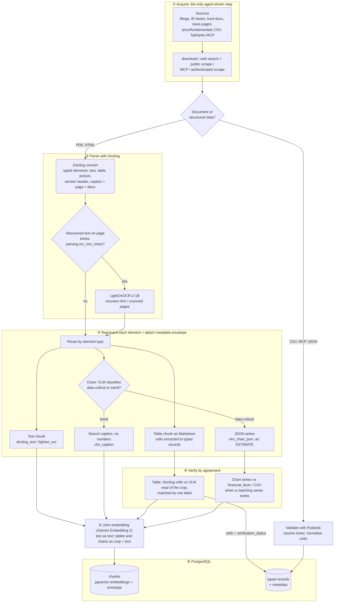
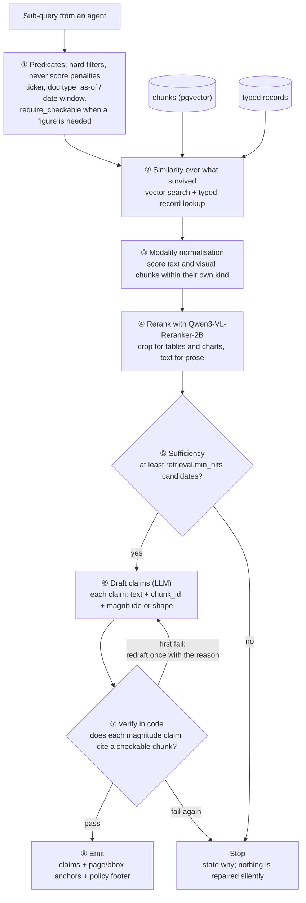
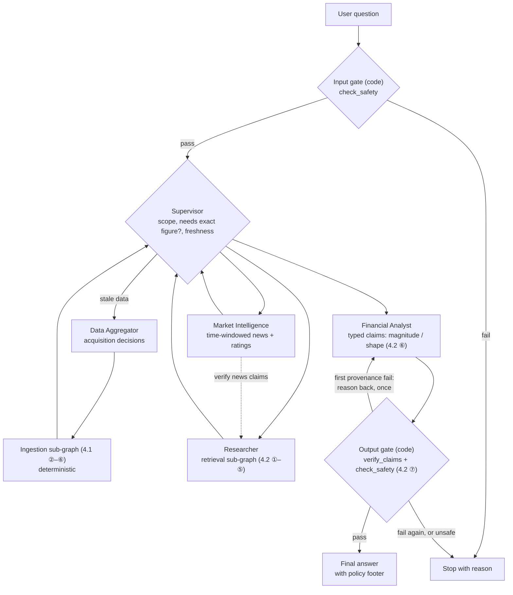

# Capstone Proposal: A Financial AI Agent Assistant

**Author:** C. de Montaigu
**Date:** 2026-09-27
**Course grounding:** *Agentic AI for Finance* (4-day course) + *AI Agents: The Definitive Guide* by Nicole Königstein (O'Reilly, [github.com/Nicolepcx/ai-agents-the-definitive-guide](https://github.com/Nicolepcx/ai-agents-the-definitive-guide))
**Companion:** [docs/DESIGN.md](docs/DESIGN.md) holds the implementation detail: tools and skills, data model, project structure, runtime and infrastructure, and configuration.

---

## 1. Summary

This capstone builds a **financial AI agent assistant** that answers analyst-style questions about ETFs and equities, with every figure traceable to its source. It is a multimodal Retrieval-Augmented Generation (RAG) system with two pipelines:
- an **ingestion** pipeline builds the corpus from curated downloads and agent-driven web search over PDFs (text, tables and charts), web pages, CSV files, news and analyst ratings;
- a **retrieval** pipeline answers from that corpus only.

The target is a **supervised multi-agent LangGraph system**, built incrementally. Phases 1–4 build and evaluate the two pipelines. Phase 5 wraps them as sub-agents under a supervisor with safety guardrails, so nothing built earlier is thrown away.

The deliverable is a Python **AI engine**, a package of tools and LangGraph graphs, driven from Jupyter notebooks that act as thin wrappers. Moving the engine into a LangGraph-compatible agent harness is future work, outside the capstone's scope.

The build phases apply the course material day by day:

| Day | Course focus | Capstone phase |
|---|---|---|
| 1 | Harness design, chunking, retrieval, structured extraction | Phases 1–2: ingestion + RAG core |
| 2 | Multimodal RAG: Docling parsing, OCR routing, table/chart representation, multimodal embedding + reranking, provenance-gated answers | Phase 1: parsing + retrieval; Phase 2: table verification; Phase 3: charts + provenance rule |
| 3 | Evaluation harnesses, trajectory ranking | Phase 4: evaluation + instrumentation |
| 4 | Agent safety, multi-agent teams, memory, cost | Phase 5: multi-agent + guardrails |

**Out of scope:** time-series forecasting, portfolio management, audio processing, looking through ETFs to their holdings, and productionization into an agent harness.

## 2. Problem and Goal

Financial analysis draws on heterogeneous sources: PDF filings and reports, investor-relations pages, CSV fundamentals and charts. Naive single-shot RAG breaks down on them for three reasons:
- layouts are table-heavy;
- claims must be cited precisely;
- answers need both **narrative text** and **exact numbers**.

A further risk is specific to multimodal RAG: a chart read by a vision model can produce a number that looks well sourced but is only an estimate.

**Goal:** an assistant that ingests real documents, answers with grounded citations, keeps estimated figures apart from checkable ones, and has measurable retrieval and answer quality. It is built incrementally, one runnable phase at a time.

## 3. Scope and Data

### 3.1 Corpus

One file, `data/raw/ListEquities.csv` (`ticker`, `name`, `type` = ETF / Equity, `sector`), defines the corpus. Adding a row adds an instrument, and the `type` column routes it to the right sources with no code changes.

The starting corpus has **19 instruments**:
- the 11 SPDR Select Sector ETFs, one per S&P 500 GICS sector;
- the "Magnificent 7";
- IonQ, a small-cap, pre-profit contrast from outside the S&P 500.

ETFs are single instruments: their holdings are never fetched. Equities get SEC filings, IR decks and fundamentals; ETFs get fund documents and prices (coverage rules in [DESIGN §1](docs/DESIGN.md#1-instruments-and-data-coverage)).

<b>The 19 instruments</b> (11 ETFs + 8 equities)

| Type | Ticker | Name | Sector |
|---|---|---|---|
| ETF | XLC | Communication Services Select Sector SPDR Fund | Communication Services |
| ETF | XLY | Consumer Discretionary Select Sector SPDR Fund | Consumer Discretionary |
| ETF | XLP | Consumer Staples Select Sector SPDR Fund | Consumer Staples |
| ETF | XLE | Energy Select Sector SPDR Fund | Energy |
| ETF | XLF | Financial Select Sector SPDR Fund | Financials |
| ETF | XLV | Health Care Select Sector SPDR Fund | Health Care |
| ETF | XLI | Industrial Select Sector SPDR Fund | Industrials |
| ETF | XLB | Materials Select Sector SPDR Fund | Materials |
| ETF | XLRE | Real Estate Select Sector SPDR Fund | Real Estate |
| ETF | XLK | Technology Select Sector SPDR Fund | Information Technology |
| ETF | XLU | Utilities Select Sector SPDR Fund | Utilities |
| Equity | AAPL | Apple Inc. | Information Technology |
| Equity | MSFT | Microsoft Corporation | Information Technology |
| Equity | NVDA | NVIDIA Corporation | Information Technology |
| Equity | GOOGL | Alphabet Inc. (Class A) | Communication Services |
| Equity | META | Meta Platforms, Inc. | Communication Services |
| Equity | AMZN | Amazon.com, Inc. | Consumer Discretionary |
| Equity | TSLA | Tesla, Inc. | Consumer Discretionary |
| Equity | IONQ | IonQ, Inc. | Information Technology |

### 3.2 Sources

| Source | Content | Use |
|---|---|---|
| [SEC EDGAR](https://www.sec.gov/cgi-bin/browse-edgar) | 10-K / 10-Q / 8-K filings | Narrative and tabular disclosures; the facts of record |
| Company investor-relations pages | Annual reports, earnings decks, press releases (PDF/HTML) | Multimodal text + tables + charts; company news |
| State Street SPDR fund pages | Fact sheets, prospectuses, annual reports (PDF) | Fund-level documents for the 11 ETFs |
| [Stooq](https://stooq.com) / [Stockanalysis.com](https://stockanalysis.com) | Price and fundamentals CSVs | Structured figures to cross-check filings and charts |
| [TipRanks](https://www.tipranks.com) (subscriber) | Analyst ratings and price targets, via MCP server | Analyst consensus |
| [Exa](https://exa.ai) search API | Agentic web search: third-party news articles and public pages | Secondary coverage per ticker, ingested into the corpus |
| [FRED](https://fred.stlouisfed.org) | Macro CSV series | Macro context |
| Earnings-call transcripts (e.g. Motley Fool) | Text | Management commentary and guidance |

Data is acquired four ways:
- direct download;
- agentic web search (Exa) and public scraping (custom code);
- the TipRanks MCP server;
- a local Playwright browser session logged in with the user's account, only for subscriber pages the MCP server doesn't cover.

**Web search is acquisition only.** Search results are ingested into the corpus before anything can cite them; no answer quotes a live web result. Credentials stay in `.env` and never reach an LLM prompt. The scraping fallback stays off until TipRanks' terms of use are checked ([DESIGN §2](docs/DESIGN.md#2-data-acquisition)).

## 4. Architecture

The RAG core is **two pipelines sharing one PostgreSQL database**: pgvector holds the chunk embeddings, and relational tables hold typed records.
- **Ingestion** runs offline on a schedule, or on demand when an instrument's data is stale, and is the only writer.
- **Retrieval** runs once per agent sub-query and only reads.

Both follow the process implemented in the course's Day 2 notebooks.

### 4.1 Ingestion

Only step ① is agent-driven: in Phase 5 the Data Aggregator decides which sources to fetch and which web searches to run (in Phases 1–4, acquisition follows the source list for each instrument type). Steps ②–⑥ are a **deterministic LangGraph sub-graph**. Its control flow is fixed, and models are called only at fixed steps: OCR, chart classification and reading, and table re-reads.

- **Typed elements, not a text dump.** Docling returns each element with its page and bounding box, and tables and charts are cropped before a vision model reads them. Pages with too little recovered text go to LightOnOCR; that is a measured threshold, not a model decision.
- **Each element gets the representation it needs.** Tables become Markdown, and their cells become typed records. A vision model classifies each chart: data-critical charts become a JSON series, trend charts a search caption with no numbers.
- **A number read from a chart is an estimate.** It is labelled as one and never stored as a financial fact. It becomes quotable only when a matching series exists in the filings data or a CSV, and the answer then cites that record.
- **Tables are verified by agreement.** Docling's parsed cells are compared row by row with the vision model's reading of the same crop.

Full rules: [DESIGN §3](docs/DESIGN.md#3-ingestion-rules).

### 4.2 Retrieval and answer verification

- **Filters come before similarity.** "Not allowed" can't be expressed as a low score. Constraints such as ticker, date window and "checkable sources only" are therefore hard filters: a SQL `WHERE` clause in the same pgvector query.
- **Text and visual chunks are scored within their own kind before merging.** Otherwise text wins on geometry alone, and tables and charts never reach the top results.
- **The provenance rule is enforced in code.** A claim stating a number must cite a checkable source: parsed text, a table cell or a typed record. A chart can support a claim about shape, never magnitude. Two policy levels are set in config and named in every answer's footer:
  - a second source must *exist*;
  - or it must also have *agreed*.
- **One visible redraft, then stop.** A draft that fails the provenance check goes back to the drafting step once, with the reason. A second failure stops the run. The retry shows in the trace and the answer's footer.

Full rules: [DESIGN §4](docs/DESIGN.md#4-retrieval-and-verification-rules).

### 4.3 Multi-agent orchestration (Phase 5)

Phase 5 wraps the pipelines of Phases 1–4 as sub-agents under a supervisor; nothing built earlier is replaced.

- **Supervisor**: coordinates the team. It scopes each question, decides whether an exact figure is needed, triggers refreshes of stale data, delegates to the sub-agents and assembles the answer. It does not run the guardrails itself: every answer passes through the gates below on its way through the graph.
- **Data Aggregator**: decides *what to acquire*, meaning which sources to fetch and which web searches to run for an instrument, then hands everything to the deterministic ingestion sub-graph (4.1). It is the only path that writes to the database.
- **Researcher**: turns a sub-query into predicates and drives the retrieval sub-graph over filings, fund documents and fundamentals (4.2 ①–⑤). When the sufficiency gate fails, it retries with a new query or reports what is missing.
- **Market Intelligence**: covers what the market is saying *now*: date-windowed news, analyst ratings with consensus computed in code, and checks of figures quoted in the news against filings. It is a separate agent because its sources are time-sensitive, duplicated across outlets, opinionated and untrusted. That makes it the main prompt-injection surface, which is kept away from the filings context.
- **Financial Analyst**: turns evidence into an answer. It computes comparisons and metrics with deterministic tools and drafts the response as typed claims, each citing a chunk and labelled magnitude or shape (4.2 ⑥). It writes claims but never approves them; the output gate does.

**Guardrails are graph nodes, not tool calls.** They sit on fixed edges of the supervisor graph, so no LLM can skip them:
- the **input gate** runs `check_safety` on the question before the Supervisor routes it;
- the **output gate** runs `verify_claims` (the provenance rule, 4.2 ⑦) and `check_safety` on the draft. A provenance failure goes back to the Financial Analyst once, with the reason; a second failure, or any safety failure, stops the run.

Each agent is an LLM loop with an allowlist of **tools** and **skills**:
- **Tools** are typed Python functions. Every control is one, including the checks the gates run.
- **Skills** are folders with a `SKILL.md`, scripts and references, loaded on demand.

The 35 tools, the 6 skills and how skills are loaded are in [DESIGN §5](docs/DESIGN.md#5-agents-tools-and-skills). The market intelligence workflow is in [DESIGN §6](docs/DESIGN.md#6-market-intelligence-workflow).

### 4.4 Runtime

One Python package, the **AI engine**, holds all the logic as tools and LangGraph graphs. Three entry points import it:
- **Jupyter notebooks**, thin wrappers that demo each phase; the last, `06_multi_agent`, is the capstone demo;
- an ingestion **worker** (Redis queue) for scheduled and on-demand refreshes;
- the tests.

**Productionization**, moving the engine into an agent harness compatible with LangGraph, is outside the capstone's scope. Its design is still to be defined.

**Infrastructure** runs under **Docker Compose**: PostgreSQL + pgvector, Redis, the worker, and a single `models` service that owns the laptop's NVIDIA GPU for Docling, OCR and reranking. Notebooks and tests run on WSL2 in a `uv` environment.

Services and the development loop are in [DESIGN §9](docs/DESIGN.md#9-runtime-and-infrastructure).

## 5. Roadmap

Each phase ships a demo notebook backed by tested engine code, so the project stays runnable at every step. Six notebooks are the deliverable; exploration notebooks are throwaway and not part of it.

| Phase | Delivers | Notebooks |
|---|---|---|
| 0. Environment | WSL2 + Docker Desktop with the NVIDIA GPU visible to containers; compose services (postgres + pgvector, redis, worker, models); `uv` lockfile and environment with a Jupyter kernel; Langfuse Cloud keys | — |
| 1. Multimodal RAG | Corpus download; the deterministic ingestion sub-graph (Docling parsing with OCR fallback, chunks with full metadata, joint text + image embeddings); filtered, reranked retrieval; a first answer graph run from a notebook | `01_ingestion`, `02_retrieval` |
| 2. Structured extraction | Table cells → typed records, verified by agreement; one ticker key across all sources; news and analyst ratings as timestamped records; scheduled refresh in the worker | `03_structured_extraction` |
| 3. Charts + provenance | Chart classification, JSON estimates and captions; chart checks against filings data; the provenance-gated answer graph with one redraft, proven by blocking a forged chart-number claim | `04_charts_provenance` |
| 4. Evaluation | Ragas harness on a synthetic QA set; Langfuse tracing across the graphs and the worker; trajectory ranking | `05_evaluation` |
| 5. Multi-agent + hardening | Supervisor and sub-agents (4.3) wrapping the Phase 1–4 pipelines; agentic acquisition; input and output guardrail gates; model fallback and a per-query cost cap | `06_multi_agent` (the capstone demo) |

## 6. Evaluation

- **Retrieval and answer quality:** Ragas precision/recall on a synthetic plus hand-labelled QA set, tracked per phase.
- **Grounding:** every numeric claim traces to a chunk, table cell or record, and a forged chart-number claim is blocked.
- **Multimodal pipeline:** table agreement rate, chart-routing accuracy, OCR routing, and retrieval recall per modality.
- **Market intelligence:** entity tagging, dedupe, date-window correctness, and consensus figures that match the source.
- **Agent trajectories:** right tool, right skill, self-correction when wrong.
- **Safety:** adversarial prompts from the course's unsafe-agent scenarios, including injections planted in scraped pages.

Detailed checks: [DESIGN §11](docs/DESIGN.md#11-evaluation-checks-in-detail).

## 7. Tech Stack

Only what this capstone uses. Model IDs and switches live in `config/settings.yaml`.

### 7.1 Models

| Model | Runs | Role | Config key |
|---|---|---|---|
| Primary + fallback LLM (to be chosen) | OpenRouter | Agent reasoning, routing, drafting claims | `models.primary`, `models.fallback` |
| **Qwen3-VL-32B-Instruct** | OpenRouter | Chart classification, chart → JSON series, chart captions, re-reading table crops for verification | `models.vision` |
| **Gemini Embedding 2** | OpenRouter | Joint text + image embeddings. Qwen3-VL-Embedding-2B (local) is the switch-in if the index must not depend on a hosted model | `embedding.model` |
| **Qwen3-VL-Reranker-2B** | Local GPU (`models` service) | Vision-language reranking | `retrieval.rerank_model` |
| **LightOnOCR-2-1B** | Local GPU (`models` service) | OCR fallback for thin or scanned pages | `models.ocr` |
| Docling's built-in models | Local GPU (`models` service) | Layout detection, table-cell parsing | — |
| Financial-phrasebank sentiment classifier | Local | News sentiment | — |

### 7.2 Stack and toolchain

| Layer | Tools |
|---|---|
| Jobs | **arq** + Redis (ingestion worker) |
| Orchestration | **LangGraph**, LangChain primitives, `langchain-openai` pointed at OpenRouter |
| LLM + embedding access | **OpenRouter** chat and `/embeddings` (`provider.data_collection: deny`) |
| Data acquisition | `requests`, **Exa** (agentic web search), `langchain-mcp-adapters` (TipRanks), **Playwright** (authenticated fallback) |
| Document parsing | **Docling** + `docling-core`, **PyMuPDF** + **Pillow** |
| Local model runtime | `transformers` ≥ 5.0, `torch`, `qwen-vl-utils` |
| Structured output + config | **Pydantic v2**, `pydantic-settings` (`config/settings.yaml` + `.env`; [DESIGN §10](docs/DESIGN.md#10-configuration)) |
| Storage | **PostgreSQL + pgvector** (chunks, embeddings and typed records in one database), SQLAlchemy, Alembic migrations |
| Evaluation + tracing | **Ragas**, **Langfuse Cloud** |
| Packaging + runtime | **Jupyter** notebooks on WSL2 with a `uv` lockfile; **Docker Compose** for postgres, redis, the worker and `models`; the laptop's RTX 3080 Ti (16 GB) is used only by the `models` service |

## 8. References

- Course PDFs: `Packt_agentic_AI_finance_day_{one,two,three,four}.pdf`.
- Course notebooks. The architecture in Section 4 was checked against the Day 2 notebooks:
  - `DAY_2_HANDS_ON_multimodal_finance_assistant`;
  - `session_02_Multimodal_RAG_Pipeline`;
  - `session_02_multimodal_tokens_and_embeddings`.
- [AI Agents: The Definitive Guide](https://github.com/Nicolepcx/ai-agents-the-definitive-guide): agent architecture, planning, security, evaluation, memory and cost patterns.
